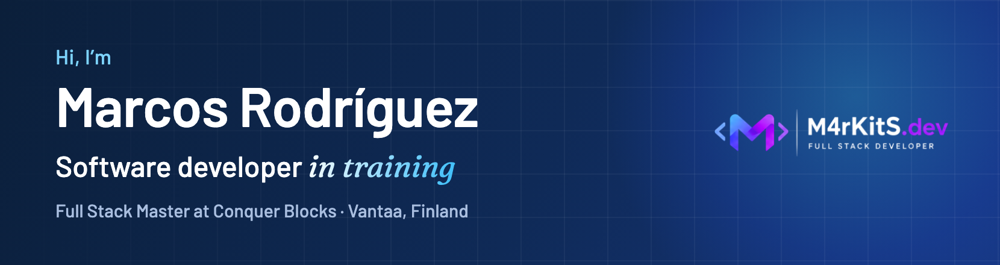
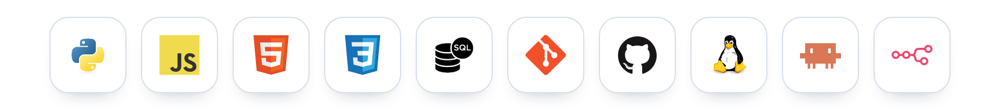

 

I'm Marcos. I'm Spanish and I live in Vantaa, Finland, with my family. I'm studying the **Full Stack Master at [Conquer Blocks](https://github.com/ConquerBlocks)**, where every module teaches me to understand and maintain what sits behind each piece of software. Computing has drawn me in since I was a boy, and the master is giving me the method to turn that passion into a profession.

I learn by building. Alongside the course I run **[m4rkits.dev](https://m4rkits.dev/en/)**, my portfolio and my web development service for small businesses, and everything I study ends up in a real project.

 

## What I've learned, by area

| Area | What I can do | Tools |
| --- | --- | --- |
| **Working environment** | Move around folders and files from the command line, run and chain commands, and set up the editor to write and review code. | Linux, terminal, Zsh, VS Code |
| **Version control** | Record changes in an orderly way, work with branches, recover an earlier version, and sync a project with GitHub. | Git, GitHub |
| **Code and logic** | Break a problem into steps with pseudocode, write Python programs with conditions, loops and functions, organise code into classes and objects, and lay out a page. | Pseudocode, Python, OOP, HTML, CSS |
| **Data** | Design tables and their relationships, query data with `SELECT`, `JOIN` and subqueries, and handle the database from Python with an ORM. | SQL, MySQL, SQLAlchemy |
| **Publishing** | Connect a repository to Cloudflare Pages, deploy a static site, use Wrangler from the terminal, and keep a site online. | Cloudflare Pages, Wrangler |

I have a certificate for each module I've finished, and you can open them all on my [portfolio](https://m4rkits.dev/en/#certificados): Pseudocode, Linux and the terminal, Git and GitHub, Python, Advanced Python, SQL, SOLID and databases, ORMs in Python, AWS Educate (Introduction to Generative AI) and AI and Logistics, a 150-hour course on virtual assistants and automation (Mainjobs).

## How I work with AI

I work with AI agents to speed up development and reduce the operational load, and I lean on what I'm learning to read, review and validate everything they produce.

- **A human in the loop.** I define the goal, an agent implements it, and I decide when we move to the next step.
- **Precise specifications.** I write the prompt with a conversational assistant before launching the coding agent, and I keep strategy and code prompts in separate chats.
- **Review and validation.** I check each result with screenshots and tests, iterate over several rounds, and verify whether the agent edited a file or regenerated it from scratch, so earlier fixes are not lost.
- **Tools.** I started with Google Antigravity and now I work with Claude Code. I prototype interfaces with Google Stitch, connected to the agent through MCP (Model Context Protocol, the standard that lets an agent use external tools). I also know n8n, the automation platform that links apps and services into workflows.
- **Limits for the agent.** API keys stay out of the code, I confirm terminal commands before they run, and agents never touch real production data.
- **Version control from day one.** Every project goes to Git and GitHub.

## Projects

**[m4rkits.dev](https://github.com/M4rKitS/M4rKitS.dev)** is my portfolio and my web development service. It is bilingual (Spanish and English), accessible, free of cookies, and published on Cloudflare Pages. It is plain HTML, CSS and JavaScript split into ES modules, with a small Python generator behind it, and I built it directing Claude Code: I decide, review and test every change.

**[tbh-strategy-web](https://github.com/M4rKitS/tbh-strategy-web)** is a real client project: the redesign of the website of TBH Strategy, a social media consultancy in Tralee, Ireland. It has its own identity, a blog to rank on Google, a contact form, and a domain migration that kept the email and the analytics intact.

### Web development for small businesses

Alongside my studies I build clear, fast websites for small businesses, in Spanish and in English. I listen, we shape the site together, and I hand it over ready to launch. You can see how I work, the plans and the examples on [m4rkits.dev/en/web-development](https://m4rkits.dev/en/web-development/).

## What I'm after

I want to make a living from technology without giving up what matters most to me, which is enjoying my time with my family. That's why I look for remote work, where I can give my best: work done with passion and attention to every detail, and useful digital solutions for whoever needs them, wherever they are.

My goal for now is simple: keep growing every day without setting limits for myself.

## Get in touch

- Portfolio: [m4rkits.dev](https://m4rkits.dev/en/)
- Email: [contact@m4rkits.dev](mailto:contact@m4rkits.dev)
- LinkedIn: [linkedin.com/in/mrodriguezhdz](https://www.linkedin.com/in/mrodriguezhdz)

 

<b>🇪🇸 Leer en español</b>

 

Soy Marcos. Soy español y vivo en Vantaa, Finlandia, con mi familia. Estudio el **Máster Full Stack de [Conquer Blocks](https://github.com/ConquerBlocks)**, donde cada módulo me enseña a entender y mantener lo que hay detrás de cada software. La informática me atrae desde niño y el máster me está dando el método para convertir esa afición en un oficio.

Aprendo construyendo. Junto al máster llevo **[m4rkits.dev](https://m4rkits.dev/)**, mi portfolio y mi servicio de desarrollo web para pequeños negocios, y todo lo que estudio acaba en un proyecto real.

### Lo que he aprendido, por áreas

| Área | Qué sé hacer | Herramientas |
| --- | --- | --- |
| **Entorno de trabajo** | Moverme por carpetas y archivos desde la línea de comandos, lanzar y encadenar comandos y preparar el editor para escribir y revisar código. | Linux, terminal, Zsh, VS Code |
| **Control de versiones** | Registrar cambios de forma ordenada, trabajar con ramas, recuperar una versión anterior y sincronizar un proyecto con GitHub. | Git, GitHub |
| **Código y lógica** | Descomponer un problema en pasos con pseudocódigo, escribir programas en Python con condiciones, bucles y funciones, organizar el código en clases y objetos y maquetar una página. | Pseudocódigo, Python, POO, HTML, CSS |
| **Datos** | Diseñar tablas y sus relaciones, consultar datos con `SELECT`, `JOIN` y subconsultas y manejar la base de datos desde Python con un ORM. | SQL, MySQL, SQLAlchemy |
| **Publicación** | Conectar un repositorio con Cloudflare Pages, publicar un sitio estático, usar Wrangler desde la terminal y mantener una web en línea. | Cloudflare Pages, Wrangler |

Tengo un certificado de cada módulo que he terminado, y puedes abrirlos todos en mi [portfolio](https://m4rkits.dev/#certificados): Pseudocódigo, Linux y la terminal, Git y GitHub, Python, Python avanzado, SQL, SOLID y bases de datos, ORMs en Python, AWS Educate (Introduction to Generative AI) e IA y Logística, un curso de 150 horas sobre asistentes virtuales y automatización (Mainjobs).

### Cómo trabajo con IA

Trabajo con agentes de IA para acelerar el desarrollo y reducir la carga operativa, y me apoyo en lo que aprendo para leer, revisar y validar todo lo que producen.

- **Un humano en el circuito.** Yo defino el objetivo, un agente lo implementa y yo decido cuándo se pasa al siguiente paso.
- **Especificaciones precisas.** Redacto el prompt con un asistente conversacional antes de lanzar el agente de código, y separo la estrategia y los prompts de código en chats distintos.
- **Revisión y validación.** Compruebo cada resultado con capturas y pruebas, itero en varias rondas y verifico si el agente editó un archivo o lo regeneró desde cero, para no perder correcciones previas.
- **Herramientas.** Empecé con Google Antigravity y ahora trabajo con Claude Code. Prototipo interfaces con Google Stitch conectado al agente mediante MCP (Model Context Protocol, el estándar que permite a un agente usar herramientas externas). También conozco n8n, la plataforma de automatización que une aplicaciones y servicios en flujos de trabajo.
- **Límites para el agente.** Las claves de API quedan fuera del código, confirmo los comandos de terminal antes de que se ejecuten y los agentes nunca tocan datos reales de producción.
- **Control de versiones desde el primer día.** Cada proyecto va a Git y GitHub.

### Proyectos

**[m4rkits.dev](https://github.com/M4rKitS/M4rKitS.dev)** es mi portfolio y mi servicio de desarrollo web. Es bilingüe (español e inglés), accesible, sin cookies y está publicado en Cloudflare Pages. Es HTML, CSS y JavaScript puros, dividido en módulos ES, con un pequeño generador en Python detrás, y lo construí dirigiendo a Claude Code: yo decido, reviso y pruebo cada cambio.

**[tbh-strategy-web](https://github.com/M4rKitS/tbh-strategy-web)** es un proyecto real para un cliente: el rediseño de la web de TBH Strategy, una consultora de redes sociales de Tralee, Irlanda. Tiene identidad propia, un blog para posicionar en Google, un formulario de contacto y una migración de dominio que mantuvo el correo y la analítica intactos.

#### Desarrollo web para pequeños negocios

Junto a mis estudios hago webs claras y rápidas para pequeños negocios, en español y en inglés. Escucho, planteamos la web juntos y la entrego lista para publicar. Puedes ver cómo trabajo, los planes y los ejemplos en [m4rkits.dev/desarrollo-web](https://m4rkits.dev/desarrollo-web/).

### Lo que busco

Aspiro a vivir de la tecnología sin renunciar a lo que más me importa, que es disfrutar de mi tiempo en familia. Por eso busco trabajar en remoto, donde pueda dar lo mejor de mí: un trabajo hecho con pasión y cuidado en cada detalle, y soluciones digitales útiles para quien las necesite, esté donde esté.

Mi meta por ahora es sencilla: seguir creciendo cada día sin ponerme límites.

### Contacto

- Portfolio: [m4rkits.dev](https://m4rkits.dev/)
- Correo: [contact@m4rkits.dev](mailto:contact@m4rkits.dev)
- LinkedIn: [linkedin.com/in/mrodriguezhdz](https://www.linkedin.com/in/mrodriguezhdz)

